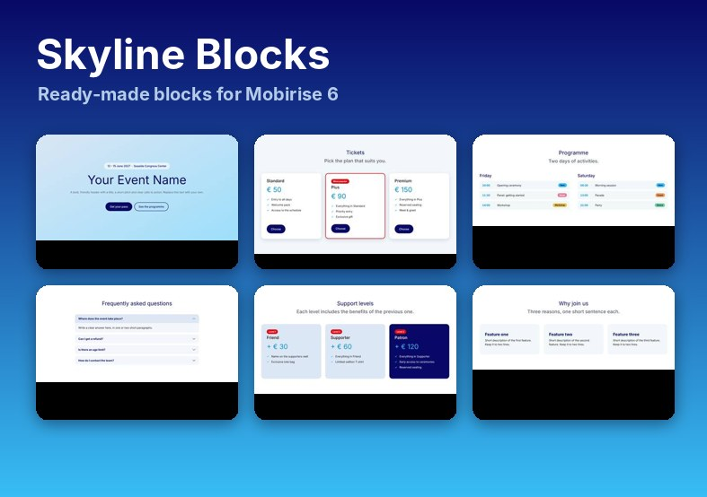

# Skyline Blocks

Extension **Mobirise 6** : une galerie de 21 blocs prêts à l'emploi (menu, bannière, tarifs, programme, FAQ, formulaire, pieds de page…) au style marine / bleu ciel, avec Bootstrap 5.



## Installation

1. Télécharger le fichier : [`skyline-blocks.mbrext`](https://github.com/QuentinMarical/Skyline/releases/latest/download/skyline-blocks.mbrext)
2. Dans Mobirise, ouvrir le menu **Extensions** et installer le fichier `.mbrext` (ou le glisser dans la fenêtre), puis redémarrer Mobirise.
3. Dans un projet, ouvrir le menu **Add Block** (le « + » de la page) : les 21 blocs sont dans le groupe **Skyline**.
   Autre méthode : le bouton **cube** ajouté dans la barre du haut (à côté des icônes d'appareils) ouvre une galerie avec miniatures ; choisir un bloc puis **ADD BLOCK TO PAGE**.
4. Personnaliser le bloc avec l'icône d'engrenage (nombre de cartes, couleurs, fond, afficher/masquer le titre, etc.).

L'extension requiert un thème Mobirise basé sur **Bootstrap 5** (les thèmes de la série 5/6) ; les anciens thèmes ne sont pas pris en charge.

## Les blocs

| Groupe | Bloc | Contenu / options |
|---|---|---|
| Navigation | `sk-menu1` | barre sticky, bouton, 1–8 entrées, couleur |
| Headers | `sk-hero1` | plein écran, capsule date/lieu, titre, texte, boutons, fond image/couleur/vidéo, overlay |
| Text | `sk-text1` | introduction centrée + signature |
| Text | `sk-positions1` | postes repliables par département (responsabilités / profil), 1–5 |
| Info | `sk-venue1` | lieu : texte, adresse, accès (métro, train, bus, voiture), image à gauche/droite |
| Info | `sk-notice1` | bandeau d'avis (note / alerte / succès) |
| Features | `sk-cards1` | 1–4 cartes, icônes, style doux / glace / contour |
| Features | `sk-goodies1` | produits : visuel, crédit artiste, badge de niveau, 4 ou 6 |
| Features | `sk-perks1` | liste d'avantages à coches + bouton |
| Features | `sk-departments1` | 2–6 équipes (titre + paragraphe) |
| Steps | `sk-steps1` | 2–4 étapes numérotées |
| Pricing | `sk-pricing1` | 2 ou 3 formules, badge « populaire » |
| Pricing | `sk-tiers1` | niveaux de soutien cumulatifs (+ prix), 2 ou 3 |
| Pricing | `sk-table1` | grille tarifaire (type de chambre × nombre de personnes) + note |
| Schedule | `sk-schedule1` | programme par jour, horaires et pastilles de catégorie |
| Gallery | `sk-gallery1` | grille de photos, 3 ou 6 |
| FAQ | `sk-faq1` | 1–6 questions (accordéon) |
| Forms | `sk-form1` | formulaire de contact (`mbr-form`) |
| CTA | `sk-cta1` | bandeau d'appel à l'action sur fond marine |
| Footers | `sk-footer1`, `sk-footer2` | colonnes + réseaux ; groupes de liens + mention légale |

Les polices (titres / texte) se règlent dans Mobirise via le *Style Editor* ; les titres sont prévus pour une police d'affichage (Shrikhand dans le thème d'origine) et retombent sur Inter.

## Organisation du dépôt

```
src/                          contenu de l'extension (ce qui est zippé dans le .mbrext)
  params.json                   nom, alias, version ; liste des composants (généré)
  components/<bloc>/            GÉNÉRÉ : template.html, style.less, thumb.png (menu « Add Block »)
  components/_images/           visuel de remplacement des fonds
  plugins/                      GÉNÉRÉ : plugin.json + skyline.css (feuille de style partagée)
  app.js                        GÉNÉRÉ : galerie (bouton cube) avec les blocs embarqués
  splash.html, splash.jpg       page de présentation dans le gestionnaire d'extensions
  thumbnail.jpg                 icône de l'extension
blocks/<Groupe>/<bloc>.html   source des blocs (balise <section> + <mbr-parameters>)
theme/skyline.css             jetons (--sk-*) et styles
tools/
  skyline.py                    fonctions communes (lecture des blocs, styles, CSS)
  build_extension.py            génère src/ et dist/skyline-blocks.mbrext
  build_preview.py              génère preview/index.html (aperçu navigateur)
  validate.py                   contrôle statique des blocs et de src/
  make_thumbs.py, shoot.js      miniatures (tools/thumbs/*.jpg et *.png)
  make_assets.py                icône, image d'accueil, visuel de fond
  test_extension.js             test de app.js avec un faux Mobirise (jsdom)
  test_less.js                  compile chaque style.less avec LESS
preview/                      aperçu navigateur (généré)
.github/workflows/build.yml   construit le .mbrext et crée la release sur un tag vN
```

## Développer

```bash
python3 -I tools/build_preview.py      # aperçu navigateur : preview/index.html
python3 -I tools/make_thumbs.py        # après un changement visuel (Node + Playwright + Pillow)
python3 -I tools/build_extension.py    # régénère src/ (à committer)
python3 -I tools/validate.py           # contrôle des blocs
python3 -I tools/build_extension.py --zip   # + dist/skyline-blocks.mbrext
```

Ajouter un bloc : créer `blocks/<Groupe>/sk-xxx.html` (première ligne `<!-- title: Nom affiché -->`), le titre et les options suivent le format Mobirise (`<mbr-parameters>`, `mbr-if`, `mbr-class`, …). Les marges (`paddingTop`/`paddingBottom`) et le fond (`bgColor` ou fieldset `bg`) sont convertis automatiquement en `_styles`. Puis lancer `make_thumbs.py`, `build_extension.py` et `validate.py`.

## Publier une version

1. Incrémenter `version` et `name` dans `src/params.json`, ajouter l'entrée au `CHANGELOG.md`.
2. Régénérer `src/` (`build_extension.py`), committer.
3. Créer et pousser le tag : `git tag v2 && git push origin v2`.

Le workflow construit `skyline-blocks.mbrext` et le publie dans la release (le lien `releases/latest/download/skyline-blocks.mbrext` pointe ensuite toujours sur la dernière version).

## Compatibilité

- Les blocs suivent le format natif des extensions Mobirise à composants (`components/<bloc>/template.html` + `style.less` + `thumb.png`, déclarés dans `params.json`, feuille de style via `plugins/`), comme l'extension [Mailform](https://github.com/witsec/mobirise-mailform) de witsec. La galerie (bouton cube) reprend la méthode de [Design Blocks](https://github.com/witsec/mobirise-design-blocks), maintenue jusqu'à Mobirise 6.0.4 et après.
- Vérifié hors de Mobirise : script de la galerie (faux Mobirise), contrôle statique des blocs (options déclarées, balises équilibrées), compilation LESS de chaque `style.less`, rendu des blocs dans Chromium.
- **Non testé dans l'application Mobirise 6.1.12 elle-même.** Si les blocs n'apparaissent pas ou qu'une option ne réagit pas, le signaler avec la version de Mobirise et le thème utilisé.

## Crédits et licence

La structure de l'extension et la méthode d'import d'un bloc s'inspirent de [mobirise-design-blocks](https://github.com/witsec/mobirise-design-blocks) de witsec (licence MIT). Le format des modèles de blocs vient des projets de référence publiés par Mobirise.

Licence MIT, voir [LICENSE](LICENSE).
